1. Установить git можно отсюда: https://git-scm.com/
Тут же можно найти подробнейшую документацию на английском.

2. Рекомендуемые найстройки установки:
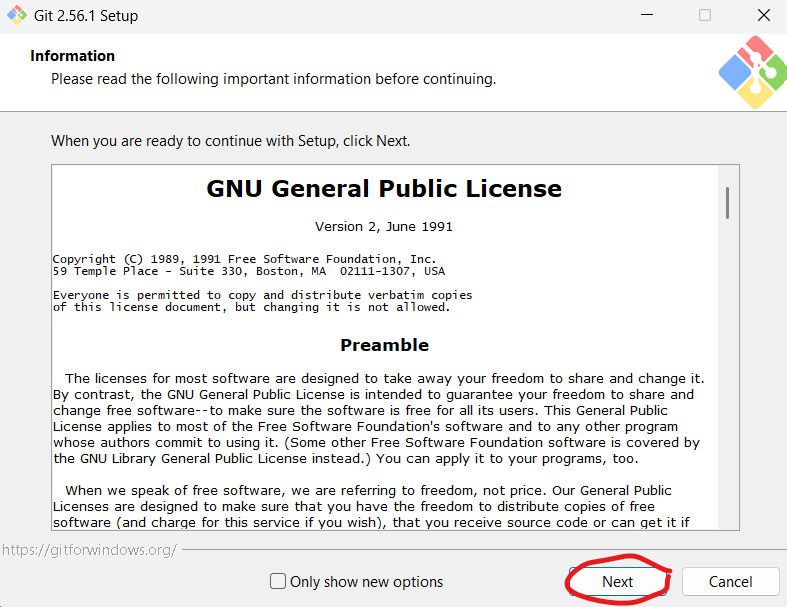
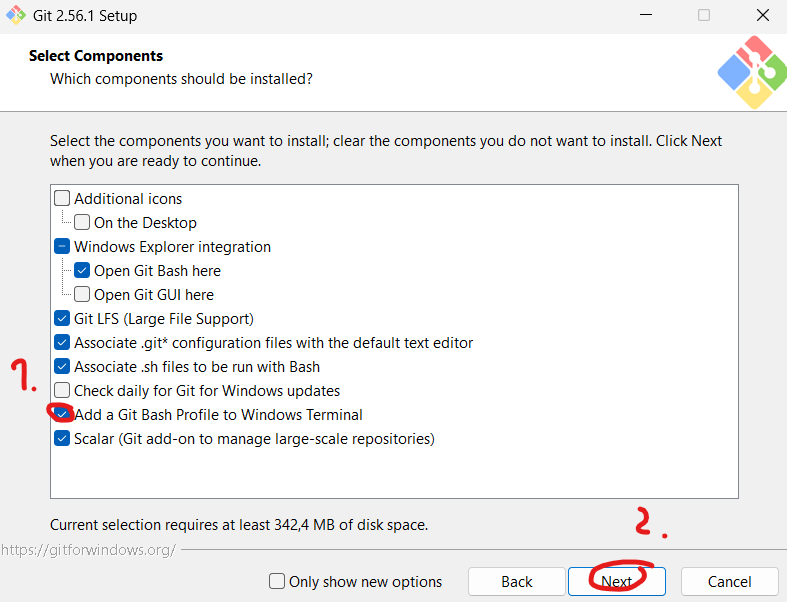
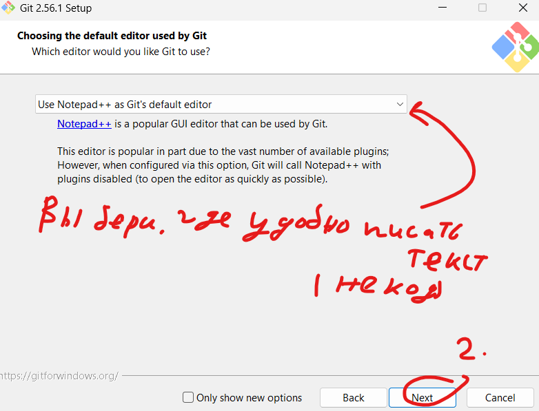
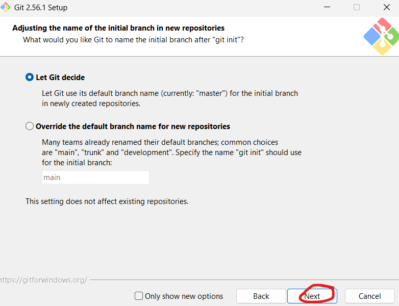
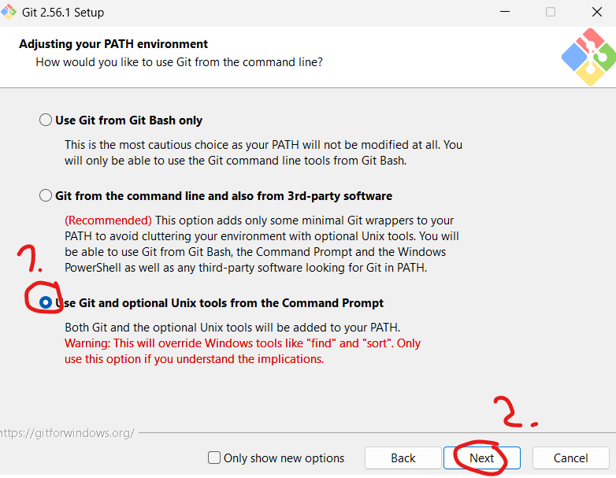
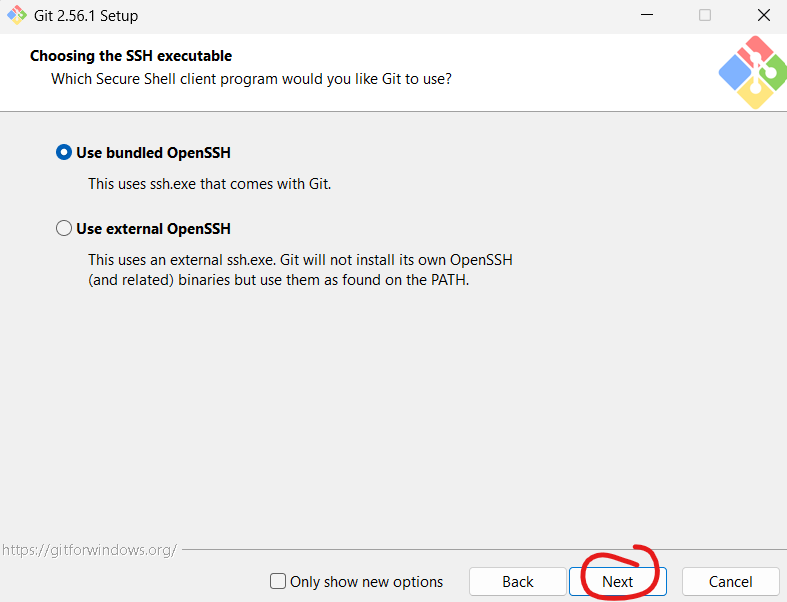
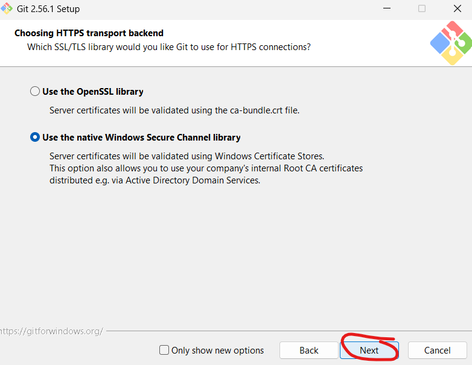
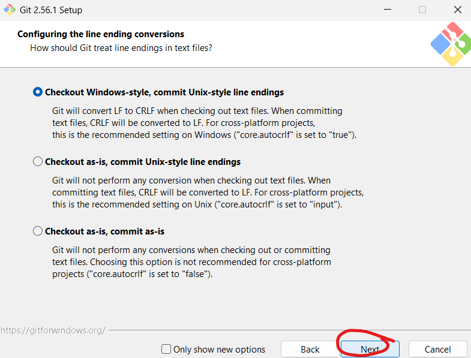
> Этот вариант может "подменить" консоль на Linux-подобную. 

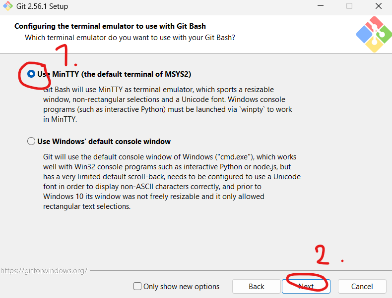
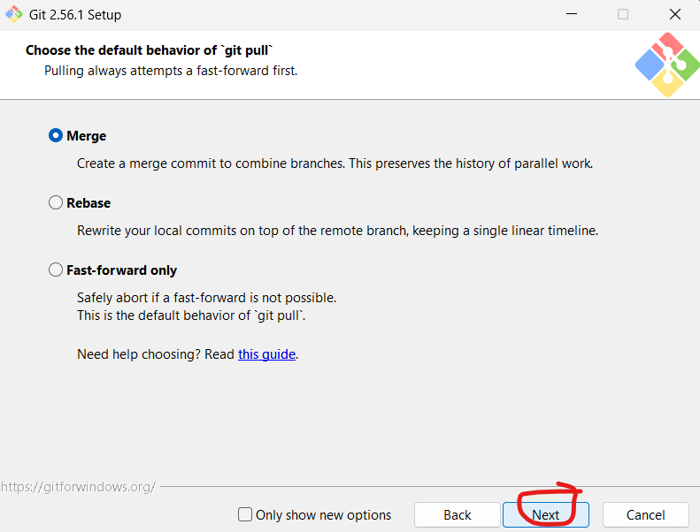
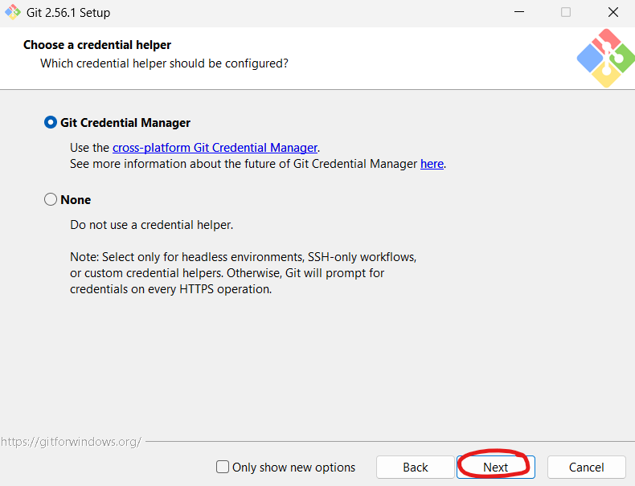
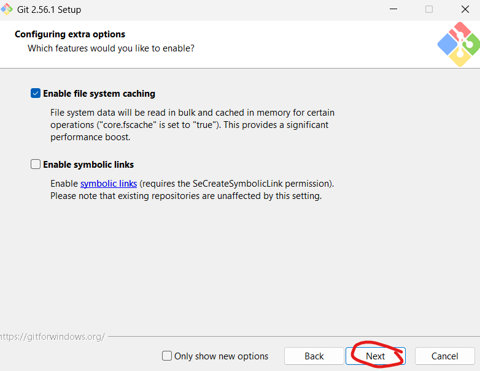

3. Чтобы починить отображение кириллицы, создайте файл 
`C:\Users\\*ВашеИмяУчётнойЗаписи*\\.bashrc` с таким содержанием:
```
export LANG=ru_RU.UTF-8
export LC_ALL=ru_RU.UTF-8
```

4. Чтобы закончить починку (они чинят разное), выполните:
```git config --global core.quotepath false```

5. Создайте папку для проекта. В ней будут лежать файлы с кодом.
`mkdir *ИмяПапки*`

6. Инициализируйте её как git репозиторий.
```
cd *ИмяПапки*
git init
```

7. Свяжите удалённый репозиторий на github и ваш локальный репозиторий:
```git remote add origin https://github.com/"LOGIN"/"REPO".git```

8. Создайте хотя бы один коммит.

9. При первой отправке изменений в удалённый репозиторий используйте команду:
```git push -u origin \*ИмяВашейВетки\*```
В дальнейшем можно выполянть просто:
`git push`